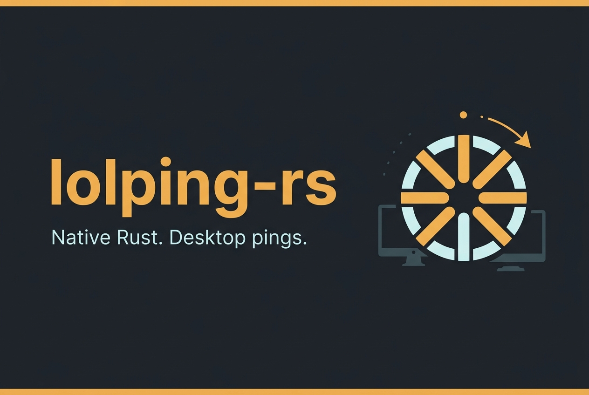

# lolPing-rs



lolPing-rs places League of Legends pings and emotes on the Windows desktop. Hold a trigger, drag to a wheel slice, and release to show its bundled animation and play its sound. The native runtime is Windows 11 x64 only; this MVP does not read or modify the League process.

> **Validation status:** the Windows implementation has been cross-target checked, but has not yet had a real Windows 11 runtime smoke test. See [Validation](#validation) before relying on it.

## Use

- Hold **Alt** and drag with the left mouse button to open the ping wheel. Hold **Ctrl** and drag for the emote wheel. Release over a slice to show its asset.
- Release in the centre, press **Esc**, or right-click to cancel.
- Short trigger taps and unrelated shortcuts are passed through. The default toggle shortcut is **Ctrl+Alt+P**.
- If a swallowed custom/Caps Lock trigger's key-up is lost, Pause then Resume (or opening Settings) explicitly re-arms it. Repeats and the matching key-up stay suppressed; if the key was already released, its next press/release pair is consumed.
- Left-click the notification-area icon to open Settings. Right-click it for Settings, Pause/Resume, or Quit.
- Settings provide trigger and toggle keys, drag threshold, fullscreen-display pause, optional trigger-click actions, ping/emote size, duration, volume, mute, and the eight assignments on each wheel. Settings use native keyboard-focusable controls.

Settings are saved to `%APPDATA%\lolPing\settings.json`. Invalid settings are rejected without replacing the existing file; defaults are used until you save new settings. Assets are embedded in the executable, so no sidecar asset directory is needed. The bundled asset files total about 58 MiB, making the executable correspondingly large.

## Build and run

Build on Windows with Rust stable for the MSVC target and Visual Studio 2022 Build Tools with the C++ workload:

```powershell
cargo build --locked --release --target x86_64-pc-windows-msvc --bin lolping
.\target\x86_64-pc-windows-msvc\release\lolping.exe
```

This is a portable executable, not an installer. It does not register itself to run at login or include an updater. The GitHub Actions workflow builds and tests the Windows target, then uploads `lolping.exe` as an Actions artifact named `lolping-windows-x64`; it does not create a GitHub Release. The executable is unsigned.

Portable checks can also be run from the repository root:

```sh
cargo fmt --all -- --check
cargo test
cargo clippy --all-targets -- -D warnings
```

## How it works

The Rust core implements gesture arbitration, wheel selection, coordinate mapping, and validated settings. The Windows runtime uses Win32 low-level keyboard and mouse hooks, tagged input replay, a layered click-through overlay, native settings controls, a notification-area menu, and `rodio` audio. Ping and emote image, animation, and sound assets are bundled into the executable. There is no Electron, WebView, JavaScript runtime, or C++ helper.

## Support and limitations

- Supported target: Windows 11 x64. Linux and macOS desktop runtimes are not implemented; a non-Windows executable only reports that the desktop runtime is unsupported.
- This app uses desktop-wide input hooks for its configured gestures. It does not access the game process, but input-hook, replay, and focus behavior still needs real Windows testing.
- Fullscreen pause is enabled by default and checks the display under the gesture. It is a window/monitor heuristic: windowed games are not detected, and Windows can restrict overlays or input around elevated/admin applications.
- The overlay is not supported over exclusive-fullscreen applications. No elevation is required.
- Mixed-DPI, negative-origin displays, animation/audio playback, tray behavior, and settings recovery have not been smoke-tested on a Windows host for this revision.
- No custom image import, startup registration, installer, updater, rooms, LAN/Nostr sharing, or macOS/Linux desktop support is included.

## Attribution and asset licensing

The source code is MIT licensed; see [`LICENSE`](LICENSE). This Rust rewrite draws on the upstream [lolPing project](https://github.com/darrenprx/lolPing), at commit [`f24a51e5a11c2b31dab72d89a571cc4025ad3c98`](https://github.com/darrenprx/lolPing/tree/f24a51e5a11c2b31dab72d89a571cc4025ad3c98). The upstream MIT attribution is retained in `LICENSE`.

The bundled League of Legends ping textures and sounds, and built-in emote images, animations, and sounds, are © Riot Games, Inc. They are **not** licensed under this repository's MIT license; bundling them does not grant redistribution rights. Verify permission before redistributing the executable or assets. lolPing is not endorsed by Riot Games. League of Legends and Riot Games are Riot Games, Inc. trademarks. The README banner is original Gemini-generated decoration, not a game asset.

## Validation

At this handoff, the following local checks passed on Linux: `cargo fmt --all -- --check`, `cargo test` (30 tests), `cargo clippy --all-targets -- -D warnings`, and Windows GNU-target `cargo check`/Clippy. A linked Windows GNU executable build could not run in this environment because `x86_64-w64-mingw32-dlltool` is unavailable. The Windows MSVC CI workflow has been added but has not run for this revision. Neither a cross-target check nor CI compilation substitutes for runtime testing; no Windows 11 smoke test has been completed.

Before treating the desktop runtime as verified, test on Windows 11 x64:

- Trigger taps pass through; drag/release selects on both wheels; centre, Escape, and right-click cancel; ordinary typing and shortcuts remain unaffected.
- Synthetic replay does not stick buttons/modifiers; modifier-up and menu-mask cases behave correctly.
- Toggle shortcut and tray pause/resume/quit work.
- A fullscreen game pauses only gestures on its display, while another monitor remains usable.
- Mixed-DPI monitors, including a negative-origin display, place overlays correctly.
- Settings save/reload, and corrupt settings remain intact unless explicitly replaced.
- Ping/emote animation, audio, and mute work as configured.
