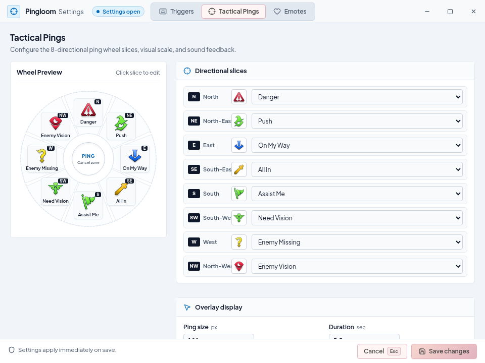
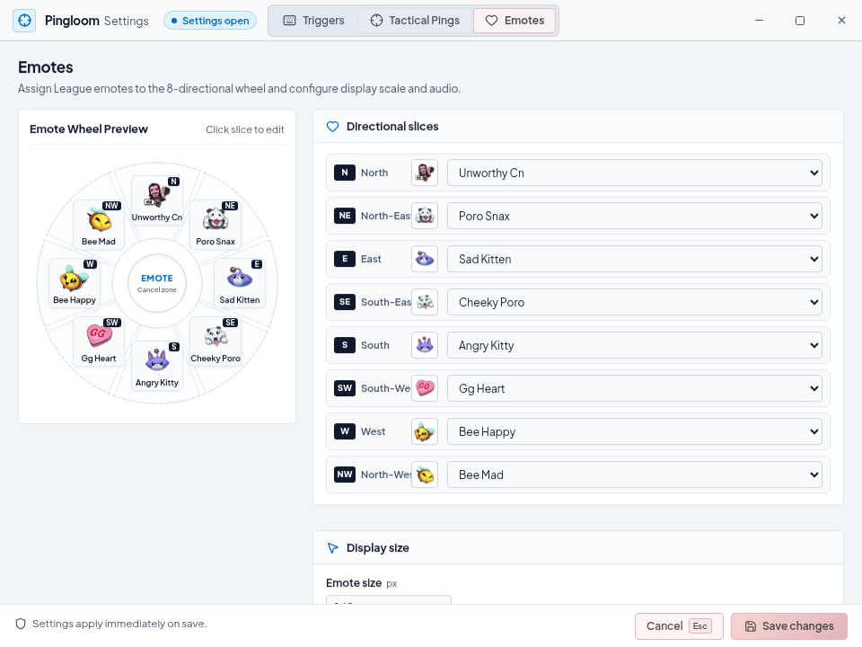

# Pingloom

<p align="center">
  
</p>

<p align="center">
  <a href="https://learn.microsoft.com/en-us/windows/release-health/windows11-release-information"></a>
  <a href="https://www.rust-lang.org/"></a>
  <a href="https://v2.tauri.app/"></a>
  <a href="https://svelte.dev/"></a>
  <a href="LICENSE"></a>
  <a href="https://github.com/zhugez/lolping-rs/issues"></a>
</p>

Pingloom places League of Legends tactical pings and animated emotes on the Windows desktop through quick radial gestures, completely independent of the game client.

Native Rust owns latency-sensitive low-level keyboard/mouse hooks, input replay, gesture state machine, transparent layered overlays, animated WebP playback, audio effects, and notification tray icon. Settings is a single bundled local Tauri 2 WebView built with Svelte 5, Vite, daisyUI, `@lucide/svelte`, and local SIL OFL variable Plus Jakarta Sans typography. Overlays and hooks are strictly native Win32, not WebViews. Pingloom is not a website, hosted service, SaaS dashboard, or production Node application.

---

## Why Pingloom?

- **Game-independent communication**: Summon tactical wheel pings (Danger, On My Way, Assist Me, Need Vision, etc.) and animated emotes anywhere on your Windows desktop.
- **Zero game hooking**: Operates entirely outside game processes via standard Windows user-input hooks (`WH_KEYBOARD_LL`, `WH_MOUSE_LL`).
- **Native execution architecture**: All gesture recognition, wheel hit-testing, and transparent overlay drawing run directly in compiled native Rust (architectural design, not an empirical latency benchmark).
- **Modern desktop utility UX**: Settings window features Windows 11 Mica vibrancy, frameless custom window controls, and pastel wedding palette tokens (`#FFF5F5`, `#F7D6D0`, `#E2B4BD`, `#4A4A4A`) with measured button text contrast ratios (4.85:1 to 8.28:1; live Windows runtime untested).

---

## Gestures & Controls

Pingloom uses an eight-slice radial selection wheel with a central cancellation zone:

1. **Activate Gesture**: Hold the configured Trigger key (default: `Alt` for pings, `Ctrl` for emotes) and **press the left mouse button**.
2. **Select Slice**: Drag the mouse outward toward one of the 8 directional slices (N, NE, E, SE, S, SW, W, NW).
3. **Trigger**: Release the left mouse button to trigger the selected ping marker or emote at the gesture origin (the initial left-press point).
4. **Cancel**: Release inside the center cancel zone, press `Escape`, or click the right mouse button to abort without triggering.
5. **Short Tap Pass-Through**: Releasing the trigger without dragging or pressing left mouse passes through cleanly to other active applications.
6. **Global Shortcut**: Press `Ctrl + Alt + P` (configurable) at any time to pause or resume gesture interception system-wide without opening Settings.

---

## Settings Interface

The Settings window provides complete customization across three focused pages:

- **Triggers**: Trigger key selectors (`Alt`, `Ctrl`, `Shift`, `Windows`, `Off`, or custom virtual keys), drag threshold numeric input (2–40 px), launch startup toggle (`enabled_on_start`), pause over fullscreen games, and global toggle hotkey editor.
- **Tactical Pings**: Interactive 8-slice radial preview with real League ping icons, real-time duplicate slot detection, 8-row slot assignment table, ping size scaling (60–220 px), display duration (1.0–8.0 s), effects volume (0–100%), tick sounds, and mute toggle.
- **Emotes**: Interactive 8-slice emote radial preview, 8-row emote assignment table with static PNG preview thumbnails (native overlay renders animated WebP), emote overlay size slider (80–300 px), and bundled emote audio toggle.

> **Note on custom titlebar:** Custom HTML window caption buttons inside WebView2 cannot natively trigger the Windows 11 DWM Snap Layout flyout on hover without Win32 `WM_NCHITTEST` non-client message interception on the top-level HWND.

### UI Previews

> **Note on screenshots:** The captures below are rendered UI previews generated against `ui/dist` using the automated headless test harness (`ui/tests/verify-ui.cjs`) with simulated Tauri 2 IPC and native chrome mocks. They are not direct Windows 11 DWM screenshots.

<p align="center">
  
  &nbsp;
  
</p>

---

## Settings Compatibility & Storage

Legacy settings storage path and schema are preserved for backwards compatibility (unverified upgrade runtime):

- **Persistence Path**: Settings persist at `%APPDATA%\lolPing\settings.json`. The legacy directory and settings schema are preserved and verified via unit test `legacy_settings_path_remains_stable_for_compatibility` (live upgrade runtime untested).
- **Application Identifier**: The Tauri application identifier is maintained as `com.lolping.desktop` in `tauri.conf.json` for update continuity and legacy compatibility.
- **Native IPC & WM Classes**: Internal native Win32 window classes (`lolping-main`, `lolping-overlay`, `lolping-settings`) and IPC command structures remain stable.

---

## Quickstart & Build Instructions

### Prerequisites

- **Target OS**: Windows 11 x64.
- **Runtime Prerequisite**: Microsoft **Evergreen WebView2 Runtime** (preinstalled on Windows 11; required for the Settings WebView).
- **Build Tools**:
  - Rust stable (`x86_64-pc-windows-msvc` toolchain).
  - Visual Studio 2022 Build Tools (with "Desktop development with C++" workload).
  - Node.js LTS and npm (build-time only; not used at runtime).

### Windows MSVC Build (Source Compilation Instructions)

*(Source build instructions from this repository; this is not a tested production release package)*

1. Build static frontend assets:
   ```powershell
   cd ui
   npm ci
   npm run check
   npm test
   npm run build
   cd ..
   ```

2. Format check and compile release binary:
   ```powershell
   cargo fmt --all -- --check
   cargo build --locked --release --target x86_64-pc-windows-msvc --bin pingloom
   ```

3. Run the compiled executable:
   ```powershell
   .\target\x86_64-pc-windows-msvc\release\pingloom.exe
   ```

### Cross-Compilation on Linux (GNU Target)

For development or continuous inspection on Linux hosts, compile using the MinGW GNU target:

```bash
# Verify frontend
cd ui && npm ci && npm run check && npm test && npm run build && cd ..

# Verify Rust host tests and formatting
cargo fmt --all -- --check
cargo test --all-targets
cargo clippy --all-targets -- -D warnings

# Cross-check and build Windows GNU executable
cargo check --locked --tests --target x86_64-pc-windows-gnu --bin pingloom
cargo clippy --locked --target x86_64-pc-windows-gnu --bin pingloom -- -D warnings
cargo build --locked --target x86_64-pc-windows-gnu --bin pingloom
```

The resulting binary is located at `target/x86_64-pc-windows-gnu/debug/pingloom.exe`. Note that GNU cross-compilation validates Rust compilation, type safety, and borrow checking, but does not execute or certify Windows 11 desktop runtime behavior.

---

## Verification & Architecture Status

<details>
<summary><strong>Architecture & Technical Evidence (Click to expand)</strong></summary>

### Verification Evidence on this Checkout

- **Rust Suite**: 50 unit tests passing (`cargo test --all-targets`) covering geometry, gesture engine, replay logic, settings schema, oversized file protection, and legacy settings path stability.
- **Frontend Suite**: 8 unit tests passing (`npm test` in `ui/`) covering slot duplication badges, asset name mappings, trigger key displays, canonical error routing, reactive drafts, compass directions, and annular SVG paths.
- **Browser Automation Suite**: 14 automated verification assertions passing (`node ui/tests/verify-ui.cjs`) using headless Chrome, asserting zero browser console errors, zero runtime warning banners, proportional wheel node coordinates, responsive reflow, and generation-aware close calls.

### Windows 11 Runtime Caveats

Real Windows 11 visual and runtime smoke testing has **not** been executed on this development host. Specifically:
- Windows-specific mailbox, hook pump, and session tests compile under `x86_64-pc-windows-gnu`, but native Win32 window message loops were not executed on a live Windows desktop.
- No claims are made regarding physical input latency, RAM consumption under load, installer compression, or pre-built downloadable installers.
- Embedded assets (textures, WebP emotes, and audio clips) total approximately 58 MiB; expect an appropriately sized executable.

### Windows 11 Pre-Release Manual Smoke Checklist

Before distributing `pingloom.exe` on Windows 11, verify the following manual test matrix:
1. **WebView2 Availability**: Launch with Evergreen WebView2 installed (normal boot) and verify error dialog when runtime is removed.
2. **Tray Lifecycle**: Open Settings from notification tray; verify low-level gestures suspend and active input replays without stuck keys.
3. **Persistence**: Modify triggers, volume, and slice assignments; click *Save changes*; verify `%APPDATA%\lolPing\settings.json` updates atomically and values persist on restart.
4. **Window Management**: Test Cancel button, `Esc` shortcut, frameless titlebar drag/maximize, and tray *Quit*. Verify idempotent resume of gestures.
5. **Watchdog Recovery**: Force-terminate WebView2 process; confirm native watchdog tears down UI safely and resumes hooks without deadlock.
6. **Multi-Monitor / High-DPI**: Test on mixed DPI displays and verify per-display fullscreen game detection correctly pauses desktop gestures.

</details>

---

## Attribution & Legal Notices

- **License**: Pingloom source code is released under the [MIT License](LICENSE).
- **Upstream Credit**: This rewrite is based on and acknowledges [upstream lolPing](https://github.com/darrenprx/lolPing) by Darren Prx at commit [`f24a51e5a11c2b31dab72d89a571cc4025ad3c98`](https://github.com/darrenprx/lolPing/tree/f24a51e5a11c2b31dab72d89a571cc4025ad3c98). Upstream MIT attribution is retained in `THIRD_PARTY_NOTICES.txt` and `LICENSE`.
- **Riot Games Assets**: Bundled League of Legends ping textures, sound effects, and emote graphics are © Riot Games, Inc. and are **not** covered by the MIT license. Bundling within this project grants no redistribution rights; verify usage rights before redistributing. Pingloom is not endorsed by Riot Games and does not reflect the views or opinions of Riot Games or anyone officially involved in producing or managing League of Legends properties.
- **Font Assets**: Bundled variable fonts for **Plus Jakarta Sans** are licensed under the SIL Open Font License 1.1.
- **Issues & Contributions**: Issue tracking and pull requests are managed at [`zhugez/lolping-rs`](https://github.com/zhugez/lolping-rs).
