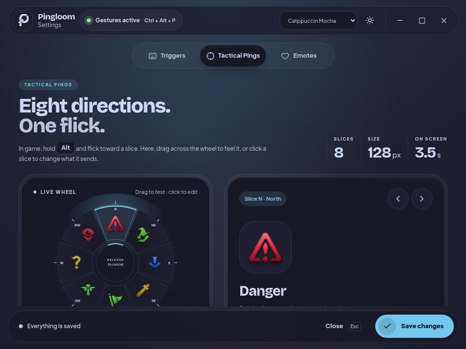
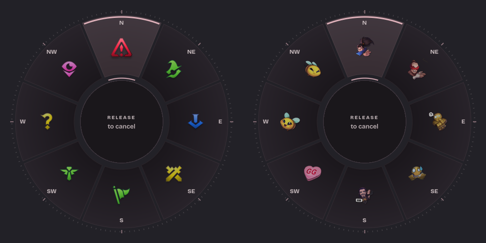

<h1 align="center">
  
  
</h1>

<p align="center">
  <a href="https://learn.microsoft.com/en-us/windows/release-health/windows11-release-information"></a>
  <a href="docs/PLATFORMS.md"></a>
  <a href="docs/PLATFORMS.md"></a>
  <a href="https://www.rust-lang.org/"></a>
  <a href="https://v2.tauri.app/"></a>
  <a href="https://svelte.dev/"></a>
  <a href="LICENSE"></a>
  <a href="https://github.com/zhugez/pingloom/issues"></a>
</p>

Pingloom places League of Legends tactical pings and animated emotes on your desktop through quick radial gestures, independent of the game client. Available for Windows, with an experimental macOS backend. **Linux: Coming soon** — public builds are temporarily paused. See [platform requirements and permissions](docs/PLATFORMS.md).

Native Rust owns latency-sensitive low-level keyboard/mouse hooks, input replay, gesture state machine, transparent layered overlays, animated WebP playback, audio effects, and notification tray icon. Settings is a single bundled local Tauri 2 WebView built with Svelte 5, Vite, daisyUI, `@lucide/svelte`, and local SIL OFL variable Plus Jakarta Sans typography. Overlays and hooks are native: Win32 on Windows, evdev/X11 + GTK/Cairo on Linux, and Quartz + AppKit on macOS—not WebViews. Pingloom is not a website, hosted service, SaaS dashboard, or production Node application.

---

## Download — v0.1.0 prerelease

| Platform | Download | Requirements |
| --- | --- | --- |
| Windows 11 x64 | [Installer](https://github.com/zhugez/pingloom/releases/download/v0.1.0/Pingloom_0.1.0_x64-setup.exe) · [portable exe](https://github.com/zhugez/pingloom/releases/download/v0.1.0/pingloom.exe) | Evergreen WebView2; unsigned |
| Linux | **Coming soon** | Public builds and downloads temporarily paused; source backend retained |
| macOS (Apple Silicon + Intel) | [App ZIP](https://github.com/zhugez/pingloom/releases/download/v0.1.0/pingloom-macos-universal.zip) | Accessibility; ad-hoc signed, not notarized; experimental |

[Release notes, build provenance and SHA-256 checksums](https://github.com/zhugez/pingloom/releases/tag/v0.1.0).

**Version stays at 0.1.0 while the prerelease is refreshed.** Download again to get the latest UI and fixes, even if your installed app also reports 0.1.0. Distinguish builds using the attached build commit/checksum. Earlier v0.2.x prereleases have been consolidated here. See [platform setup](docs/PLATFORMS.md) before running.

## Why Pingloom?

- **Game-independent communication**: Summon tactical wheel pings (Danger, On My Way, Assist Me, Need Vision, etc.) and animated emotes on supported desktop sessions.
- **Zero game hooking**: Operates entirely outside game processes via native OS input APIs; no game-process injection.
- **Native execution architecture**: All gesture recognition, wheel hit-testing, and transparent overlay drawing run directly in compiled native Rust (architectural design, not an empirical latency benchmark).
- **Native V7 Wheel**: Spaced wedges, a separate cancellation hub, theme-colored selection arcs and compass ticks/labels on the actual desktop overlay. Both Ping and Emote Wheels follow the Settings color theme immediately, including light/dark mode and all Catppuccin presets. Input behavior and Ping/Emote artwork stay unchanged.
- **Theme-aware Settings**: Pingloom Blush light/dark and Catppuccin Latte, Frappé, Macchiato and Mocha. Floating titlebar/navigation, double-bezel surfaces, a local drag-test wheel, persistent Save controls and responsive layouts. The ribbon-woven P uses the theme foreground in Settings; desktop icons use a fixed high-contrast plate. See [design details](DESIGN.md).

---

## Gestures & Controls

Pingloom uses an eight-slice radial selection wheel with a central cancellation zone:

1. **Activate Gesture**: Hold the configured Trigger key (default: `Alt` for pings, `Ctrl` for emotes) and **press the left mouse button**.
2. **Select Slice**: Drag the mouse outward toward one of the 8 directional slices (N, NE, E, SE, S, SW, W, NW).
3. **Trigger**: Release the left mouse button to trigger the selected ping marker or emote at the gesture origin (the initial left-press point).
4. **Cancel**: Release inside the center cancel zone, press `Escape`, or click the right mouse button to abort without triggering.
5. **Short Tap Pass-Through**: Releasing the trigger without dragging or pressing left mouse passes through cleanly to other active applications.
6. **Global Shortcut**: Press `Ctrl + Alt + P` (configurable) at any time to pause or resume gesture interception system-wide without opening Settings.

---

## Settings Interface

**Gestures stay active while Settings is open**, unless you manually pause them or a native safety/permission failure pauses input. Try pings/emotes while editing; draft changes apply only after **Save changes**. Saving cancels any gesture in progress safely, then uses the new configuration without changing your manual pause state. Runtime status refreshes every five seconds.

Only **one Pingloom runtime per user/settings directory** can run. A held OS file lock rejects a second launch before hooks/tray start, and is released even on process termination. A leftover `.instance.lock` file is harmless; do not delete it while the app is running.

Custom images are stored in `custom-emotes/` next to `settings.json`; back up/copy both when moving settings. Import does not reference your original file. This initial library has no in-app delete/rename/export controls.

The Settings window provides complete customization across three focused pages:

- **Triggers**: Trigger key selectors (`Alt`, `Ctrl`, `Shift`, `Windows`, `Off`, or custom virtual keys), drag threshold slider (2–40 px), enable-gestures-at-launch toggle (`enabled_on_start`; not OS startup registration), pause over fullscreen games, and global toggle hotkey editor.
- **Tactical Pings**: Interactive 8-slice radial preview with real League ping icons, real-time duplicate slot detection, 8-row slot assignment table, ping size scaling (60–220 px), display duration (1.0–8.0 s), effects volume (0–100%), tick sounds, and mute toggle.
- **Emotes**: Illustrated picker and eight-slice radial preview, native bundled WebP animations, size (80–300 px) and audio controls. **Import custom emote** accepts PNG/JPG stills and GIF/WebP animations for wheel and trigger-tap choices: up to 8 MiB / 2048×2048 input, native artwork capped at 512px, 16 custom images / 32 MiB total. Animations are limited to 300 frames / 30 seconds / 128 MiB decoded memory and loop during the normal **3-second** native emote lifetime. Reduced motion uses the first frame. No custom audio yet. Import stores artwork immediately; assignments apply only on Save. Every native renderer decodes animated frames off the input thread and waits for them instead of flashing a differently sized PNG thumbnail; built-in motion within WebP assets is preserved.

> **Note on custom titlebar:** Custom HTML window caption buttons inside WebView2 cannot natively trigger the Windows 11 DWM Snap Layout flyout on hover without Win32 `WM_NCHITTEST` non-client message interception on the top-level HWND.

### Current UI

Use the **Color theme** selector in the titlebar and the adjacent light/dark toggle (Pingloom Blush or Catppuccin Latte / Frappé / Macchiato / Mocha). Appearance is saved locally immediately, independently of gesture configuration Save. The native Ping and Emote Wheels follow the same theme, even while open; their palette is restored from `appearance.json` next to `settings.json` when the app restarts.

Select a wheel slice, then choose an image from the visual catalog alongside it. Drag the test wheel and release to preview locally; release in its centre to cancel. Preview sounds are synthesized, not the bundled clips. Full dropdown assignments remain under **All 8 assignments**. Emotes includes custom PNG/JPG/GIF/WebP import.

<p align="center">
  
</p>

Native V7 Wheel (offscreen native renderer on a test background, not an OS screenshot):



---

## Settings Compatibility & Storage

Legacy settings storage path and schema are preserved for backwards compatibility (unverified upgrade runtime):

- **Persistence Path**: Settings persist at `%APPDATA%\Pingloom\settings.json`. The legacy directory and settings schema are preserved and verified via unit test `legacy_settings_path_remains_stable_for_compatibility` (live upgrade runtime untested).
- **Application Identifier**: The Tauri application identifier is maintained as `com.pingloom.desktop` in `tauri.conf.json` for update continuity and legacy compatibility.
- **Linux/macOS Storage**: New per-user `pingloom/settings.json` files under the OS config directory; see [platform paths](docs/PLATFORMS.md).
- **Native IPC & WM Classes**: Internal native Win32 window classes (`pingloom-main`, `pingloom-overlay`, `pingloom-settings`) use the new brand; IPC command structures remain stable.

---

## Quickstart & Build Instructions

### Prerequisites

- **Target OS**: Windows 11 x64 and experimental macOS (universal). **Linux: Coming soon**; source-only development remains available. [Build/runtime prerequisites](docs/PLATFORMS.md).
- **Windows Runtime Prerequisite**: Microsoft **Evergreen WebView2 Runtime** (preinstalled on Windows 11; required for the Settings WebView).
- **Build Tools**:
  - Rust stable (`x86_64-pc-windows-msvc` toolchain).
  - Visual Studio 2022 Build Tools (with "Desktop development with C++" workload).
  - Node.js LTS and npm (build-time only; not used at runtime).

### Windows MSVC Build (Source Compilation Instructions)

*(Source build instructions from this repository; this is not a tested production release package)*

1. Build static frontend assets:
   ```powershell
   cd ui
   npm ci
   npm run check
   npm test
   npm run build
   cd ..
   ```

2. Format check and compile release binary:
   ```powershell
   cargo fmt --all -- --check
   cargo build --locked --release --target x86_64-pc-windows-msvc --bin pingloom
   ```

3. Run the compiled executable:
   ```powershell
   .\target\x86_64-pc-windows-msvc\release\pingloom.exe
   ```

### Native macOS / Linux source development

Linux is **Coming soon**: no public Linux packages or release CI are currently offered. The source backend remains for development.

Build the frontend as above, then run `cargo build --locked --release --bin pingloom` on the target OS. Launch `target/release/pingloom --settings` to open Settings without a tray click. macOS releases use an app bundle; Linux needs explicit input-device access. [Full instructions and unverified acceptance checklist](docs/PLATFORMS.md).

### Cross-Compilation on Linux (GNU Target)

For development or continuous inspection on Linux hosts, compile using the MinGW GNU target:

```bash
# Verify frontend
cd ui && npm ci && npm run check && npm test && npm run build && cd ..

# Verify Rust host tests and formatting
cargo fmt --all -- --check
cargo test --all-targets
cargo clippy --all-targets -- -D warnings

# Cross-check and build Windows GNU executable
cargo check --locked --tests --target x86_64-pc-windows-gnu --bin pingloom
cargo clippy --locked --target x86_64-pc-windows-gnu --bin pingloom -- -D warnings
cargo build --locked --target x86_64-pc-windows-gnu --bin pingloom
```

The resulting binary is located at `target/x86_64-pc-windows-gnu/debug/pingloom.exe`. Note that GNU cross-compilation validates Rust compilation, type safety, and borrow checking, but does not execute or certify Windows 11 desktop runtime behavior.

---

## Verification & Architecture Status

<details>
<summary><strong>Architecture & Technical Evidence (Click to expand)</strong></summary>

### Verification Evidence on this Checkout

- **Rust Suite**: Portable core regressions and native-target tests (`cargo nextest run --locked --all-targets` in CI) covering geometry, gesture engine, replay logic, settings schema, oversized file protection, and legacy settings path stability.
- **Frontend Suite**: 9 unit tests passing (`npm test` in `ui/`) covering slot duplication badges, asset name mappings, trigger key displays, canonical error routing, reactive drafts, compass directions, and annular SVG paths.
- **Browser Automation Suite**: Automated verification assertions passing (`node ui/tests/verify-ui.cjs`) using headless Chrome, asserting zero browser console errors, zero runtime warning banners, proportional wheel node coordinates, responsive reflow, reduced-motion wheel positioning and field reveal, rapid tab navigation, pressed feedback, hidden-window spinner suspension, and generation-aware close calls.

### Runtime Caveats

Physical Linux/macOS gesture, permission, overlay and mixed-DPI acceptance is also unverified. CI runs native-target tests and builds, not a physical desktop. Linux is X11-only; macOS bundles are ad-hoc signed and not notarized.

### Windows 11 Runtime Caveats

Real Windows 11 visual and runtime smoke testing has **not** been executed on this development host. Specifically:
- Windows-specific mailbox, hook pump, and session tests compile under `x86_64-pc-windows-gnu`, but native Win32 window message loops were not executed on a live Windows desktop.
- Native CI-built downloads are available above; they do not establish physical input latency, RAM consumption under load or successful desktop acceptance.
- Embedded assets (textures, WebP emotes, and audio clips) total approximately 55 MiB; expect an appropriately sized executable.

### Windows 11 Pre-Release Manual Smoke Checklist

Before distributing `pingloom.exe` on Windows 11, verify the following manual test matrix:
1. **WebView2 Availability**: Launch with Evergreen WebView2 installed (normal boot) and verify error dialog when runtime is removed.
2. **Tray Lifecycle**: Open Settings from notification tray and use ping/emote gestures while it remains open. Verify an existing gesture is not cancelled just by opening/closing Settings; explicit pause stays paused. Save mid-gesture must cancel safely without stuck keys.
3. **Persistence**: Modify triggers, volume, and slice assignments; click *Save changes*; verify `%APPDATA%\Pingloom\settings.json` updates atomically and values persist on restart.
4. **Window Management**: Test Cancel button, `Esc` shortcut, frameless titlebar drag/maximize, and tray *Quit*. Verify idempotent resume of gestures.
5. **Watchdog Recovery**: Force-terminate WebView2 process; confirm native watchdog tears down UI safely and resumes hooks without deadlock.
6. **Multi-Monitor / High-DPI**: Test on mixed DPI displays and verify per-display fullscreen game detection correctly pauses desktop gestures.

</details>

---

## Attribution & Legal Notices

- **License**: Pingloom source code is released under the [MIT License](LICENSE).
- **Upstream Credit**: This rewrite is based on and acknowledges [Pingloom](https://github.com/zhugez/Pingloom) by zhugez at commit [`f24a51e5a11c2b31dab72d89a571cc4025ad3c98`](https://github.com/zhugez/Pingloom/tree/f24a51e5a11c2b31dab72d89a571cc4025ad3c98). Upstream MIT attribution is retained in `THIRD_PARTY_NOTICES.txt` and `LICENSE`.
- **Riot Games Assets**: Bundled League of Legends ping textures, sound effects, and emote graphics are © Riot Games, Inc. and are **not** covered by the MIT license. Bundling within this project grants no redistribution rights; verify usage rights before redistributing. Pingloom is not endorsed by Riot Games and does not reflect the views or opinions of Riot Games or anyone officially involved in producing or managing League of Legends properties.
- **Font Assets**: Bundled variable fonts for **Plus Jakarta Sans** are licensed under the SIL Open Font License 1.1.
- **Issues & Contributions**: Issue tracking and pull requests are managed at [`zhugez/pingloom`](https://github.com/zhugez/pingloom).
